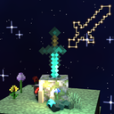

# Forged in Memory



Every tool, weapon and armor piece you own gets a life story.

I always wondered how many blocks my first diamond pickaxe actually mined before I accidentally threw it in lava. Now I know. Forged in Memory quietly follows every item with durability from the moment you get it: where it was born, every block it broke, every mob it killed, every hit it took for you. When it dies, it gets an obituary. And all your gear lives on as stars in a night sky you can fly around, Skyrim skill tree style, connected by where its materials came from.

## What it tracks

Pretty much everything. Blocks mined (by type, per day, per biome, how deep), ores and diamonds found, kills by mob (and how: mid-air, at night, while on fire, one-hit, revenge kills...), damage dealt, biggest hit, kill streaks, arrows shot and accuracy, damage your armor absorbed and from what, attacks your shield blocked, how far your elytra flew, fish caught, crops harvested, repairs, Mending, enchantments, renames, smithing upgrades, XP spent on it, time held, distance travelled together, biomes seen, sunsets watched, how many times it saved your life...

Every item also gets a title from what it did most ("Diamond Pickaxe, the Deep Delver", "Dragonslayer", "Gone Too Soon"), a zodiac sign based on the day it was born, personality traits, a nemesis, rankings against your other gear, and a pile of fun facts ("Stacked up, every block it mined would reach from bedrock to the build limit 56 times").

## When something dies

Items die for real reasons: worn out while mining, burned in lava, pricked by a cactus, blown up by a creeper, lost in the void, despawned, sacrificed in an anvil. Gear you drop when you die goes missing, and if you don't get it back in time, it's gone.

You get a toast, a bell, its ghost floating up, and an obituary in chat with the cause, an epitaph and the exact coordinates (click to copy, so you can go back for it). Epitaphs are respectful for a normal death, epic for one that fell in battle, and a roast when you threw your Mending pickaxe into lava.

## The star sky

Press **Home** (or the little ✦ next to your inventory) to open it. Every kind of gear is a constellation with a glowing outline drawing behind it: pickaxes, axes, blades, archery, armor stacked like a body, shields, wings. Every item is a star. Gold lines show which tool gathered the materials for which item, dashed lines show who replaced whom, purple ones show anvil merges. Your Soul star sits in the middle.

Drag to look around, scroll to zoom, click a star for its full story (Obituary, Story, Life, Work, Fights, World and Family tabs). Space gives you a tour, F shows the whole sky, and there's a Hall of Records with your armory's records and causes of death.

## Servers

Tracking happens on the server side, so:

- **Singleplayer:** just install it, everything works.
- **Server with the mod + you with the mod:** everything works.
- **Server with the mod, player without it:** they can join fine, their items are still tracked, they just don't see anything until they install it.
- **Vanilla server:** nothing is tracked yet (planned).

## Requirements

- Minecraft 26.3, Fabric Loader 0.20.1+
- [Fabric API](https://modrinth.com/mod/fabric-api)
- [YetAnotherConfigLib](https://modrinth.com/mod/yacl) for the settings screen (optional, the mod works without it)
- [Mod Menu](https://modrinth.com/mod/modmenu) to open the settings from the mods list (optional, there's also a ⚙ button on the star sky)

## Settings

Themes (Skyrim, Ember, Frost, Void, Aurora, Monochrome) or your own colour per constellation, star brightness, nebula, effect levels for slower PCs, which notifications you want, the epitaph tone, tooltip style, and how long dropped gear stays missing before it counts as lost.

## Building

```
./gradlew build
```

The jar ends up in `build/libs/`.

## License

MIT. Made by k3ytel.
